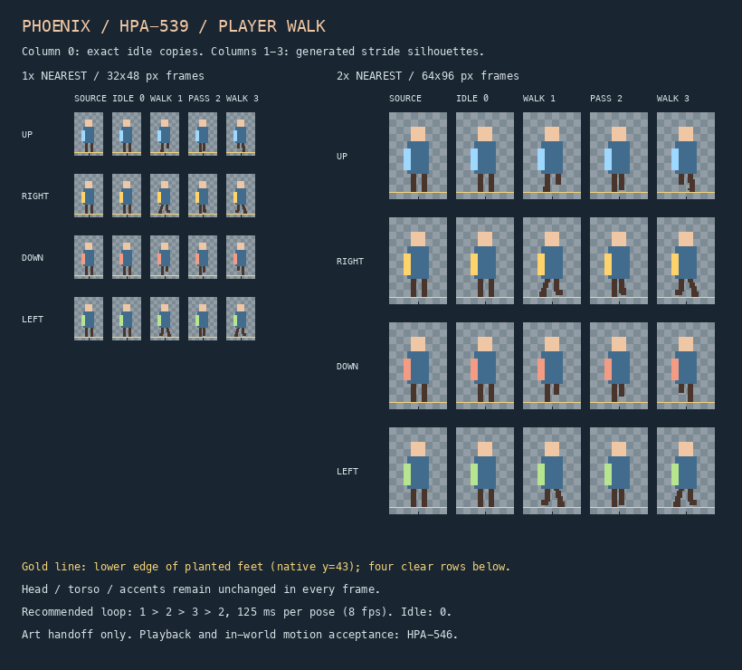

# HPA-539 player walk-sheet handoff

Art-only delivery for [HPA-539](https://linear.app/cwchanap/issue/HPA-539/image-generation-produce-the-phoenix-player-walk-cycle-sheet).
Playback belongs to [HPA-546](https://linear.app/cwchanap/issue/HPA-546/game-feel-play-the-player-walk-cycle-while-moving);
the current player scene and controller continue using the proof sheet.

## Asset and frame mapping

`assets/sprites/player-walk.png` is a **128×192 RGBA PNG**: four columns and four rows of **32×48** frames.
Row order is `WorldMath.Facing`: UP, RIGHT, DOWN, LEFT. No flipping, rotation, or fractional scaling is required.

| Row / facing | Column 0 | Column 1 | Column 2 | Column 3 | Future Sprite2D indices |
| --- | --- | --- | --- | --- | --- |
| 0 / UP | Exact source idle 0 | First stride | Passing | Opposite stride | 0–3 |
| 1 / RIGHT | Exact source idle 1 | First stride | Passing | Opposite stride | 4–7 |
| 2 / DOWN | Exact source idle 2 | First stride | Passing | Opposite stride | 8–11 |
| 3 / LEFT | Exact source idle 3 | First stride | Passing | Opposite stride | 12–15 |

Frame rectangle: `Rect2i(column * 32, row * 48, 32, 48)`.
The future consumer uses `hframes=4`, `vframes=4`, `frame=facing*4+column`, retaining `offset=(0,-24)`.
Every frame retains head top `y=8` and planted foot bottom `y=43`, leaving rows 44–47 transparent.
The frame's bottom-center anchor is `(16,48)`; the source art's four-pixel gap above that anchor is deliberately preserved.
The head, torso, and facing accent (all pixels above `y=34`) remain exact source copies in **every** pose.
There is no baked shadow.

Recommended timing: **8 fps / 125 ms per pose**, walking loop **1 → 2 → 3 → 2**.
The repeated passing pose gives both leg swaps the same transition with these three authored walk poses.
Column 0 is idle only; stop/reset behavior and final motion tuning remain HPA-546 work.

## Visual evidence



The contact sheet shows the actual proof frame beside columns 0–3 at **1× and 2× nearest**.
The gold line marks the lower edge of native row 43; the bottom-center tick identifies the unchanged anchor.
Checkerboard is evidence-only and is absent from the transparent runtime texture.
Evidence is behind `.gdignore` so Godot imports only the runtime sheet.

## Generation and cleanup

- Tool: built-in ChatGPT `image_gen`, transparent-background edit, 2026-10-29. No CLI/API fallback or external artwork.
- Edit reference: the four committed `proof-player.png` frames, repeated across a 128×192 staging canvas and enlarged exactly 8× with nearest filtering.
- One generated take at 1024×1536 supplied the twelve walking leg silhouettes. The tool did not expose a model identifier.
- Cleanup: nearest-neighbor reduction to 128×192; retain the generated per-frame leg silhouettes only within native `y=34..43`; alpha threshold `>=128` becomes opaque and lower alpha becomes transparent; retained leg pixels are snapped to source brown `#4A352D`.
- The source head/torso/accent pixels at `y=0..33` are copied back into all poses. This corrects generated color/edge drift without regenerating approved pixels. Column 0 is copied in full, including transparent RGB bytes, directly from each source frame.
- No limb redrawing, new colors, soft alpha, rescaled characters, source-art changes, or runtime code changes. Generated-source originals and local normalization tooling are not committed.
- The Godot-generated `player-walk.png.import` uses lossless compression, no mipmaps, and the existing alpha-border setting. The project already uses nearest texture filtering.

### Prompt (verbatim)

```text
Use case: identity-preserve
Asset type: Godot pixel-art player walk-cycle texture, edit of the supplied reference sheet.
Input image: /tmp/phoenix-hpa-539/walk-reference-8x.png is the EDIT TARGET. It is the actual approved 32x48 pixel character repeated in a 4-column by 4-row layout at exact nearest-neighbor 8x enlargement (1024x1536 image, each cell 256x384). Transparent canvas.
Primary request: Preserve the simple block-art character and create THREE modest walking poses in columns 1, 2, 3 of EACH row. Column 0 must remain unchanged. Row order top to bottom is UP, RIGHT, DOWN, LEFT; these are the game's existing directional variants and retain their existing small accent colors. Do not redesign the faceless simple proof character.
For each row: column 1 is first leg forward / other leg back, column 2 is a narrow passing stride, column 3 is the opposite leg forward / other leg back. A clear alternating walking silhouette, small arm counter-swing. Side-facing rows swing legs horizontally along facing; up/down rows use subtle alternating leg lengths/positions. Keep all planted feet at the same original ground baseline. Gentle walk, not running, no dramatic pose.
Style: EXACTLY the reference's extremely minimal blocky pixel art. Peach rectangular head, solid slate-blue rectangular shirt, dark-brown thin legs, existing small facing accent. Same scale, same head and body proportions, flat solid colors, no new outline or shading. Not a detailed RPG person. Preserve the head and torso pixels as much as possible; change mainly limbs.
Grid: Keep the 4x4 regular aligned grid with every character centered at the same position in its cell; no cell borders or labels. Keep native pixel blocks aligned to the enlarged 8x grid. Logical occupied height remains y=8 through y=43 inside each 32x48 cell, feet baseline y=43 (image at enlarged y=351 within each cell). Keep at least four logical transparent rows below feet and eight above head. No moving or cropping the heads, no scale changes. Foot sweep can extend only modestly sideways, retaining a center ground contact.
Palette: only existing source colors: peach #F0C7A5, shirt #426C8D, legs #4A352D, accents #FFD36B / #9FD8FF / #F49C83 / #B7E48F; full transparency elsewhere. Binary alpha, no soft edge, no antialiasing, no shadow, no background, no text, no watermarks.
Output: the edited 1024x1536 transparent image only.
```

## Validation

Local image checks cover PNG decode, exact size/RGBA mode, binary alpha, source-only palette, all four idle frames equal byte-for-byte, three distinct non-idle poses per row, unchanged upper pixels, common `y=8..43` bounds, horizontal padding, and no detached opaque pixels in any frame.
Native and nearest-2× contact-sheet inspection covers relative scale, leg silhouettes, and planted foot alignment.
Godot 4.7.1 import completed; a temporary headless resource check loaded the compressed texture and verified all sixteen frame coordinates and the unchanged `Rect2(-16,-48,32,48)` sprite geometry at `(0,-24)`.

Hashes (SHA-256):

| Artifact | SHA-256 |
| --- | --- |
| `assets/sprites/proof-player.png` (unchanged reference) | `cbfde4ad91acf65310b6f3431fa5da83e16d52307d792b35577c47a9c7394228` |
| `assets/sprites/player-walk.png` | `5551d2f286d591bf9d5ab8677dc6d19039ba54af8fc9678ab3e1327756941f0f` |
| `tests/visual/hpa-539/contact-sheet.png` | `ea35ad49e2d85918bb1d6817bc6d85d3f61e1252e3f1d498a43ff6be8c3fa2f8` |

Playback, in-world motion acceptance, and subjective timing have not been tested here because this ticket does not change the live player.
